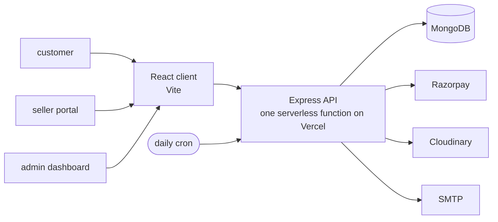

<p align="center">
  
</p>

<p align="center">
  <b>A marketplace for luxury fashion, with a court of sellers, a real checkout, and an admin who approves who gets in.</b><br>
  <sub>A full-stack MERN commerce platform with three roles, Razorpay payments, seller onboarding, and a one-project Vercel deployment.</sub>
</p>

<p align="center">
  <sub>
    <a href="#overview">OVERVIEW</a> &nbsp;·&nbsp;
    <a href="#quick-start">QUICK START</a> &nbsp;·&nbsp;
    <a href="#three-roles">THREE ROLES</a> &nbsp;·&nbsp;
    <a href="#runs-without-accounts">RUNS WITHOUT ACCOUNTS</a> &nbsp;·&nbsp;
    <a href="#run-it">RUN IT</a> &nbsp;·&nbsp;
    <a href="#deploy-it">DEPLOY IT</a> &nbsp;·&nbsp;
    <a href="#tests">TESTS</a>
  </sub>
</p>

<br>

<table>
  <tr>
    <td><sub>STACK</sub><br><b>MongoDB · Express · React · Node</b></td>
    <td><sub>LANGUAGE</sub><br><b>TypeScript</b></td>
    <td><sub>PAYMENTS</sub><br><b>Razorpay</b></td>
    <td><sub>IMAGES</sub><br><b>Cloudinary</b></td>
    <td><sub>HOSTING</sub><br><b>Vercel, one project</b></td>
  </tr>
</table>

## Overview

Darbar is a full-stack marketplace for luxury fashion with three roles: customers who browse and buy, sellers who apply and run their own storefronts, and admins who decide who gets in.

> [!NOTE]
> Every outside service has a development stand-in (emails print to the console, payments are simulated, uploads return a placeholder), so a fresh clone runs end to end with only MongoDB. In production the stand-ins switch off.

## Quick start

```bash
cp .env.example .env
npm run install:all && npm run seed
./run.sh                 # client :5173, API :5001
```

## Architecture




## Three roles

<table>
  <tr>
    <td width="33%" valign="top"><b>Customer</b><br><sub>Browse collections, keep a wishlist and a cart, check out, review what you bought, and apply to become a seller.</sub></td>
    <td width="33%" valign="top"><b>Seller</b><br><sub>A seller portal to list products with images, manage inventory, and fulfil orders.</sub></td>
    <td width="33%" valign="top"><b>Admin</b><br><sub>Approve seller applications, manage users and products, and read platform analytics.</sub></td>
  </tr>
</table>

Around that: email verification and password resets, coupons, recently viewed items, a daily abandoned-cart job, and a live "someone just bought this" feed.

## Runs without accounts

Every third-party service has a development fallback, so a fresh clone works end to end with nothing but MongoDB.

| Service | Not configured, in development | Configured |
|---|---|---|
| SMTP | emails print to the server console; new accounts are verified automatically | real verification, reset and order emails |
| Razorpay | a simulated test-mode payment | real checkout |
| Cloudinary | uploads return a placeholder image | real uploads |

In production (`NODE_ENV=production`) the fallbacks switch off: email verification and real payment keys become mandatory.

## Run it

Node 18+ and a MongoDB (local `mongod` or Atlas).

```bash
cp .env.example .env
npm run install:all      # root, client and server
npm run seed             # 18 products, a sample coupon, an admin and a seller account
./run.sh                 # client on :5173, API on :5001, logs in .dev.log
./stop.sh
```

## Deploy it

One Vercel project with **Root Directory set to `client`**: the Vite app is served statically and the whole Express API runs as a single serverless function.

1. Create a MongoDB Atlas cluster and allow `0.0.0.0/0`, since Vercel has no fixed IPs.
2. In Vercel, set `MONGODB_URI`, `JWT_ACCESS_SECRET`, `JWT_REFRESH_SECRET` and `CRON_SECRET`. Add `ALLOW_MOCK_PAYMENTS=true` until real Razorpay keys are in.
3. Seed Atlas once from your machine: `MONGODB_URI="mongodb+srv://..." SEED_ADMIN_PASSWORD="..." npm run seed`.
4. Deploy, then open **`/api/diagnostics`**. It lists any missing variables and whether the database connects.

Vercel's Hobby plan has no WebSockets, so the live purchase feed is off there.

## Tests

```bash
npm run test
```

The server suite runs on Jest and Supertest against an in-memory MongoDB, with a separate database per worker. The client suite runs on Vitest and React Testing Library. Where the in-memory server cannot be downloaded, point the tests at any running MongoDB with `TEST_MONGODB_URI`.
